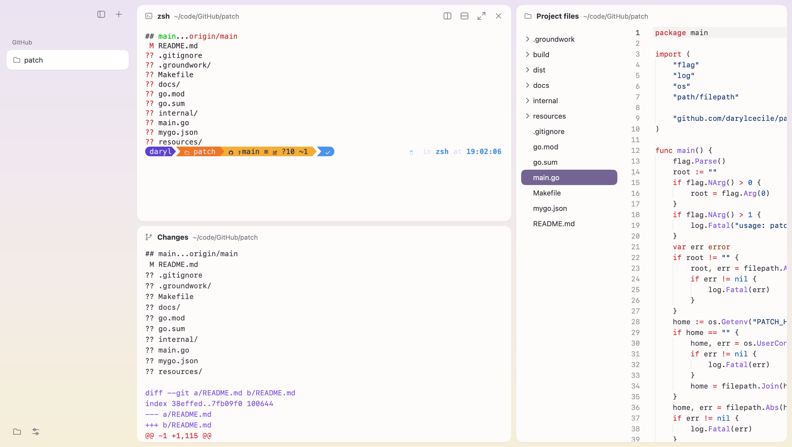
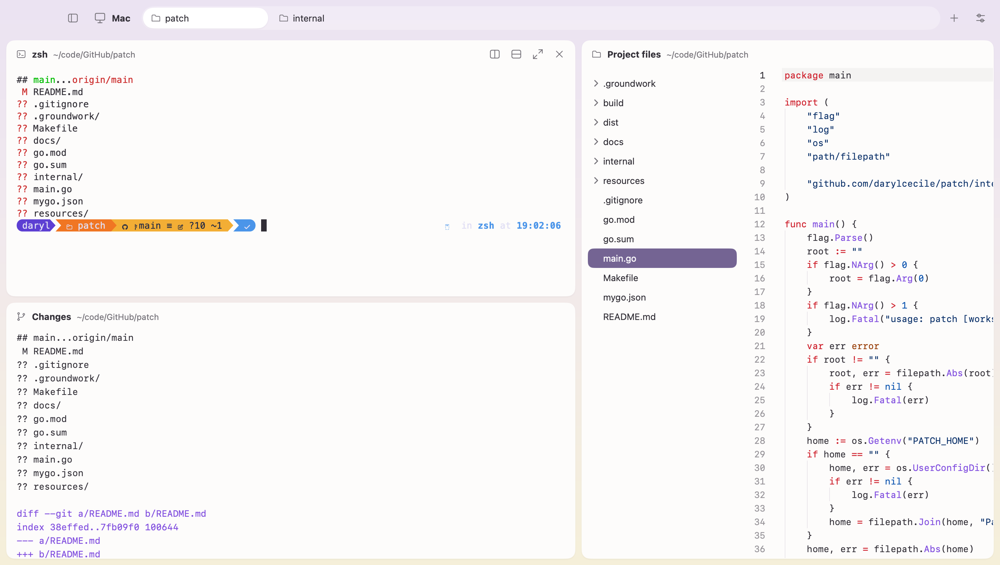
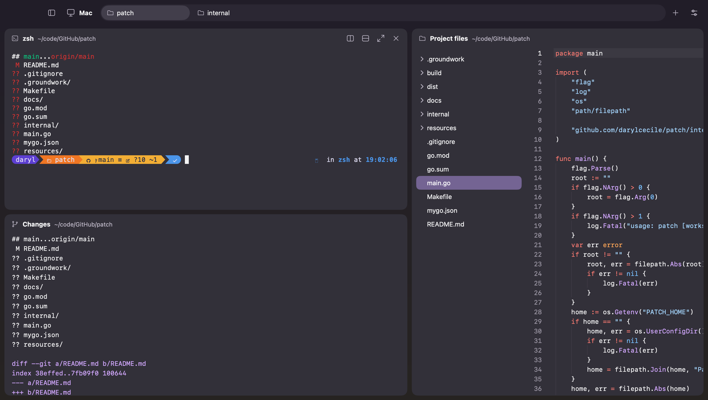
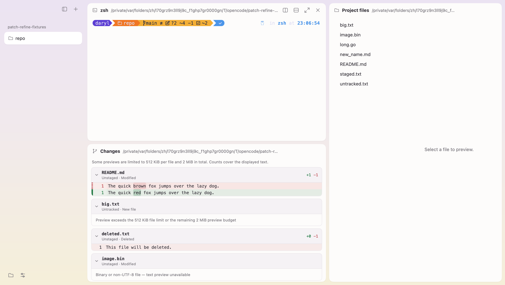
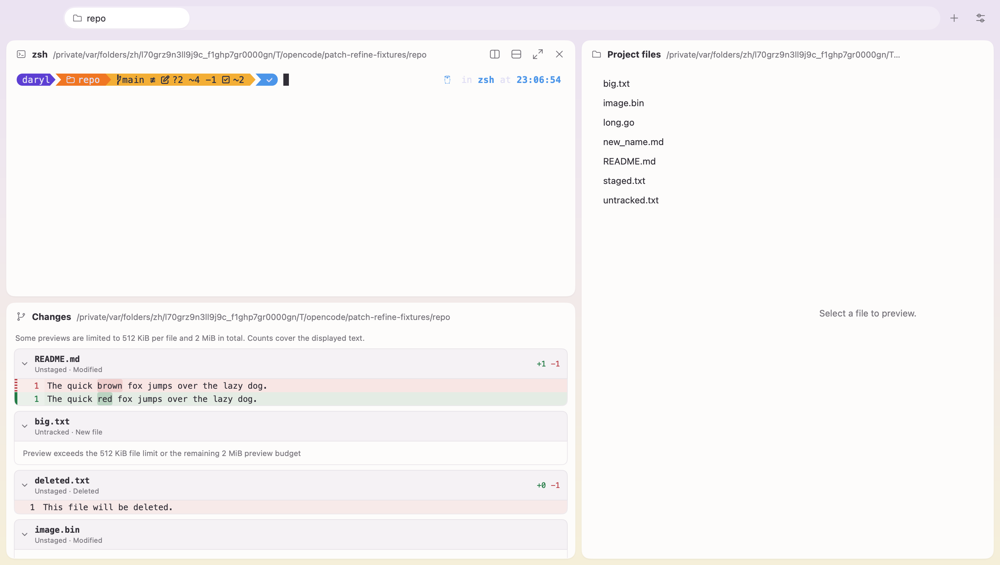
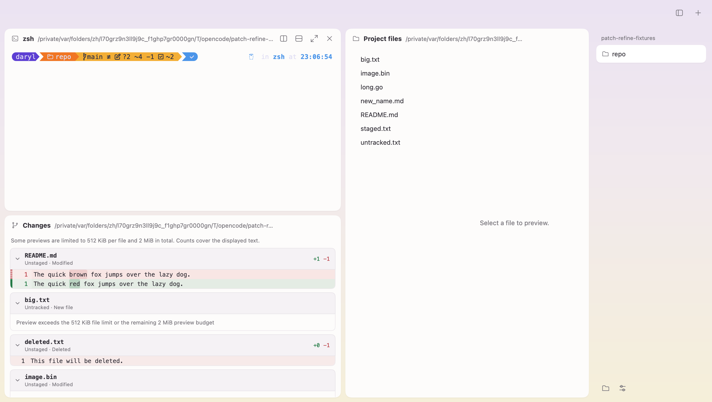
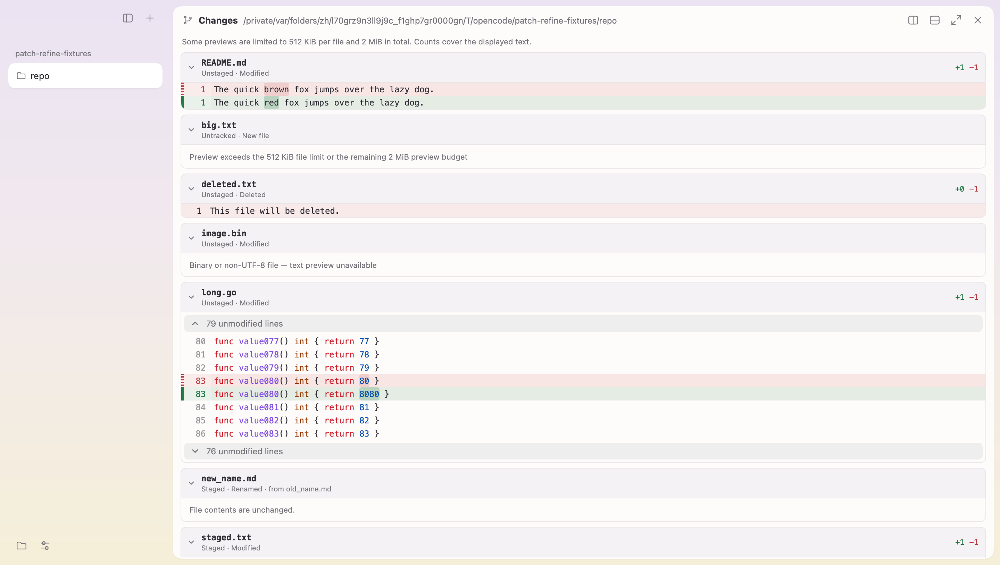
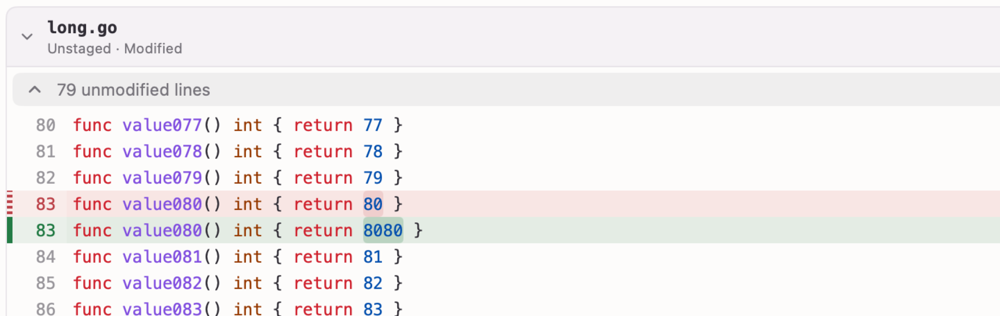
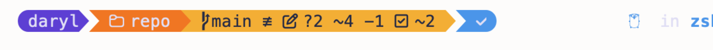
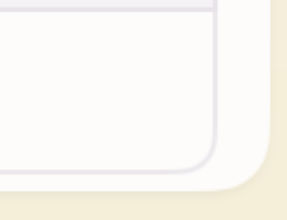

# Native verification: initial Patch shell

This report records what the running macOS app was observed to do, and what remains unverified. Unit tests and builds are reported separately; they do not establish native rendering or terminal continuity.

## Source and environment

| Item | Value |
| --- | --- |
| Patch source | Working tree based on `a2f3d1c` (uncommitted) |
| Final debug binary (`make debug`) | `7b94f7ee33e1cd75dfe39cafab3eef69062bb097c4d4176716edfb30bbc54be1` |
| Final release executable (`Patch.app`) | `e52b4acd21512088a0ae20cafdb74c1220c634cf6d00b7d1dd898d064a8206dd` |
| MyGo / Go | `6842ad5e0aa2` (pinned with its CLI) / 1.27.3 |
| Terminal symbol fallback | Nerd Fonts v3.5.1 `SymbolsNerdFontMono-Regular.ttf`, after Menlo on macOS |
| Host | Apple M2, 16 GiB, macOS 26.6.2 |
| Window | 1440×814 pt content (the display's usable height), captured at 2× |

The checks used the `e2e` debug build with an explicit `MYGO_AUTOMATION` socket and an isolated `PATCH_HOME`. Real pointer, keyboard and menu input was sent through the [MyGo automation protocol](https://github.com/egoist/mygo/blob/6842ad5e0aa2cd168166e0a4ae12c0cd0f527a3d/docs/plugins/automation.md). Assertions read the accessibility tree and the saved `session.json`/`config.json`, without writing to them. Terminal continuity was proven by typing `echo "$$ $(tty) <nonce>" > <file>` into the real shell and comparing the shell PID and TTY. Browser loads used a local HTTP page whose script sent a request every 500 ms. No external service was used.

Functional and focus checks ran on debug build `f343ce87…`. The font and content checks ran on `cb88a5db…`. The final polish build was then rechecked only for the details it changed, and it produced the screenshots below.

## Verified

- **Layout:** a fresh launch opens Terminal above Changes on the left and full-height Files on the right, with a sidebar and no `/` workspace.
  - Launching from `/` without an argument shows **Open a project** and saves no workspace.
  - Older saved state with `both` navigation, a `/` workspace and a three-panel group loads without error. That workspace is shown as **File system**. Every saved panel stays reachable from the header selector and **Panel → Next Saved Panel**, and no panel is deleted.
- **Navigation:** sidebar mode and tabs mode each show one navigation surface. In tabs mode, the workspace pills sit in the title bar, and dragging a pill reorders the workspaces.
- **Panels:**
  - Dropping a header on a card edge splits the card, and dropping it in the centre swaps the two panels. A preview names the target before release.
  - Panel IDs survive moves, and no tab group is created.
  - Dragging a gutter 120 pt moved the neighbouring card exactly 120 pt. Double-clicking or pressing Enter resets the split to 0.5.
  - Keyboard Tab reaches a split, and an arrow key changes its ratio by 0.02.
  - Zoom shows one card; restore shows them all again.
- **Terminal:**
  - The same shell process and TTY survived docking, swapping, zoom/restore and leaving then revisiting a workspace.
  - Commands typed immediately after startup, a header drop, a gutter drag, a workspace click or zoom/restore reached the shell without an extra click.
  - Quitting ended Patch's shells.
- **Restart:** Patch restored workspace descriptors, IDs, order, split ratios, navigation and appearance settings, window size and card geometry.
- **Content:**
  - Files previews selected UTF-8 files.
  - Changes shows the real Git status and diff, or **No Git repository** for a folder outside Git.
  - The bundled symbols render the user's prompt icons and the sampled BMP and supplementary private-use glyphs (`E0A0 E0B0 F07C E725 F418 F00C EA60 F0219 F01A7`) on the terminal grid, with true bold.
  - Native controls is opened from the Developer menu as a single instance, and its sample controls respond.
- **Browser:** no webview or request exists until **Go**. A restart restores the address without loading it. Closing the panel stopped the page's requests.
- **Final polish build:** the changed details were rechecked in a fresh isolated state.
  - Keyboard focus on a split shows only a short accent pill, with no full-height ring.
  - Changes text aligns with the header, and `.DS_Store` is hidden.
  - A workspace in a subfolder shows the repository-root header and paths relative to the repository root.
  - The Browser's utility buttons are flat, and the selector for older multi-panel groups sits beside the title.

## Failures found during verification

- **Product, fixed:** the first native review rejected the design: three navigation levels, boxed controls, two-line headers, divider lines, a `/` workspace on first launch and raw Git errors.
  - The rebuilt shell matches the Kero sidebar and GoRex tab references.
  - On `f343` and earlier, prompt icons in the Basic Multilingual Plane private-use range rendered as `?` boxes, because the system monospace cascade selected LastResort. Menlo as the primary font, with the same symbols fallback, fixed it on `cb88`.
- **Test driver, not product:** several early failures came from the driver itself.
  - It treated an exited but unreaped child process as still running, which looked like a quit hang. Measured quits take 0.13–0.25 s.
  - Some selectors matched controls in the wrong card.
  - One read raced the 250 ms autosave.
  - One step expected the wrong active panel.
  - All of these were rerun and passed.

## Measurements

These are scoped facts from single runs, not budgets or percentiles.

- **Binary sizes on the final build** (file sizes only): debug `build/patch` is 22,585,762 bytes; the release executable inside `Patch.app` is 15,766,736 bytes.
- **Main-process RSS:** 96,240 KiB (about 94 MiB), from one `ps -o rss` snapshot of the Patch process on the debug build, with three panes and the browser closed.
  - This excludes shells, WebKit helpers and GPU physical footprint.
  - It is not a whole-application measurement or a PRD budget result.
- **Frames:** with `MYGO_FRAME_STATS=all`, every logged frame was drawn on the GPU.
- **Not measured:** input-latency percentiles, startup budgets and idle CPU.

## Not verified

- Window-level OS screen capture was unavailable because screen-recording permission was not granted. Pixels from the system webview and the macOS window controls (traffic lights) were therefore not captured. MyGo's window capture contains the app's content only.
- A 1440×900 content size could not be shown on this display.
- Platforms other than macOS on Apple silicon.

## Screenshots

These are from the initial-shell build `7b94f7ee…`, which the refinement batch below superseded. That UI still showed the host name and the raw Changes output. Files previews `main.go` and the terminal has run `git status -sb`. They show window content only; the macOS window controls are drawn by the system and do not appear.

## Refinement batch: tab style, diff review, glyph size

The final debug binary is `a1fa526041a3fdde920aaeae738227a9894d17d242b8a79b22c2f236c9a0f6ae`; the release executable is `50161696dcd20188abb0e57503c8d85968d8b69339b52f47500a8f6537209951`. Checks used the same e2e method, with isolated `PATCH_HOME` folders and small Git fixtures outside the project. Results that predate the final binary come from earlier refinement builds and are not rerun because the later builds left that area untouched. Each item names its build.

### Verified natively

- **Title bar** (`0f5c5387…`): no host-name block.
- **Tab style menu** (`0f5c5387…`):
  - **Above** shows workspace pills in the title bar and no sidebar toggle. **Left Side** and **Right Side** show the sidebar on that side and no pills.
  - The native radio check marks were read through accessibility.
  - **Hide Sidebar** keeps sidebar navigation and presents no pills.
  - Resizing to 900×700 does not change the mode.
  - Mode, visibility and position persist across restart.
- **Pills and sidebar** (`c92ea235…`):
  - The hover × is vertically centred inside the pill.
  - A held press shows a pressed fill.
  - The keyboard focus outline follows the whole pill, × included.
  - The Right Side inset is a 12 pt margin, mirroring Left Side.
- **Prompt icons** (`0f5c5387…`): prompt icons are larger and balanced with the text. The user chose this "Kero sizing", including ink overhanging into an adjacent non-space character, so that overhang is accepted.
- **Card corners:**
  - Files viewer (`0f5c5387…`): both bottom corners stay clipped after scrolling to the end, an edge dock, a gutter drag and 900×700.
  - Changes card (`c92ea235…`): clipped in light and dark.
  - Files preview (`c92ea235…`): stops at the last line instead of scrolling past the end.
- **Changes diff** (`a1fa5260…`, `cfe6a346…` and `c92ea235…`):
  - Real file cards with headers that stay pinned while scrolling.
  - Scope and status, +/− counts, and red and green rows with gutter bars and word-level highlights.
  - Line numbers: one column in unified layout, by design.
  - Folded unmodified context that expands on demand.
  - Inline notes for binary, size-limited and rename-only files; clean and non-repository states.
  - A one-line modified file, a deleted file and an untracked file show only their real lines.
- **200 changed files** (`c92ea235…`): first load took 0.34 s and **Panel → Refresh** took 0.35 s. At most one Git child process was observed at a time. These counts come from 20 ms sampling, so they are lower bounds.

### Failures found and fixed during this batch

- The diff highlighter crashed with `comparing uncomparable type panels.diffTokens` on the second frame.
- Diff rows were about 240 pt tall, because `LineHeight` was given in points instead of as a multiplier.
- A file's final newline produced phantom empty rows.
- Word highlights used inconsistent colours.
- The pill focus ring was incomplete and pills had no pressed state.
- The right-side sidebar inset did not mirror the left.
- The Files preview scrolled past the end of the file.

Each fix was confirmed on a later build.

### Not verified natively

- **Unified, Split, Collapse all and Expand all** live in the panel's popup menu, which the automation could not open or reach. Three methods were tried:
  - Shift+F10 on the focused header;
  - pressing the narrow **Panel actions** button;
  - a real OS right-click on the header, followed by an accessibility lookup.

  The split layout and collapse/expand all therefore rest on source and headless tests only.
- No claim is made about the Windows runtime, the Windows caption controls (source only), or traffic-light and webview pixels (screen-recording permission unavailable).

### Measurements

The final debug binary is 22,798,322 bytes and the release executable is 15,950,304 bytes (file sizes only). No budget claims are made.

### Current screenshots

These show window content only (no macOS window controls), from fresh isolated state on the fixture repository.

